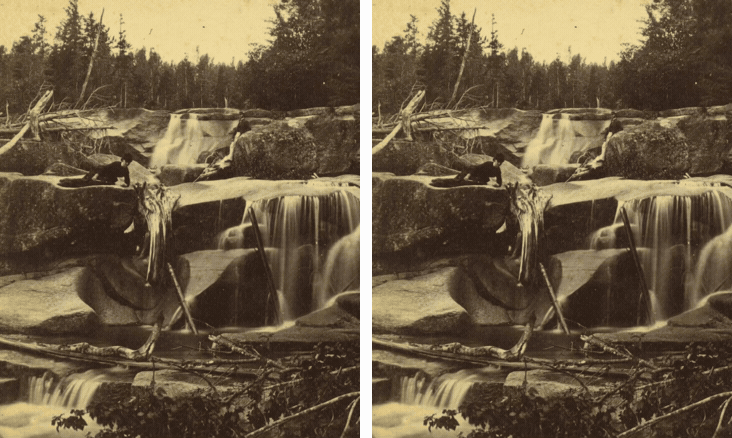
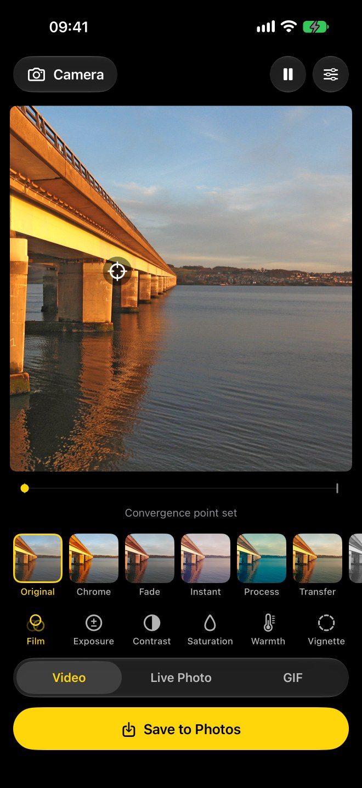
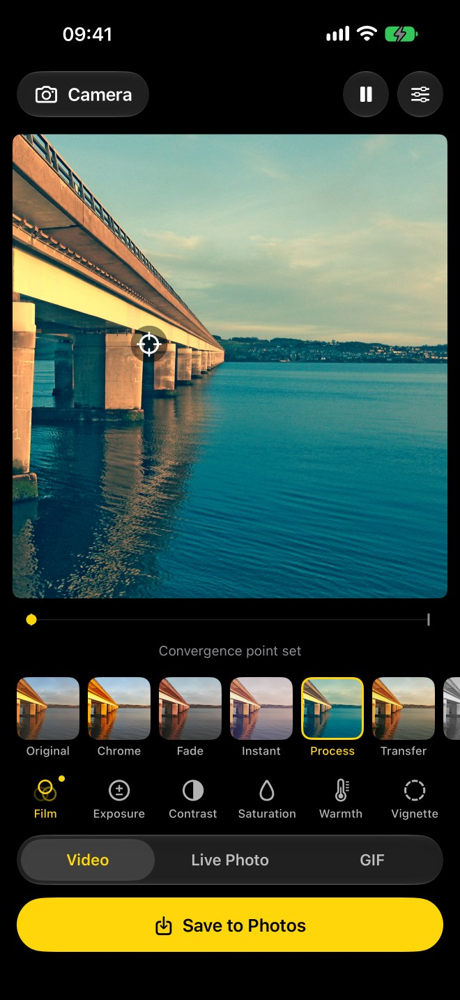
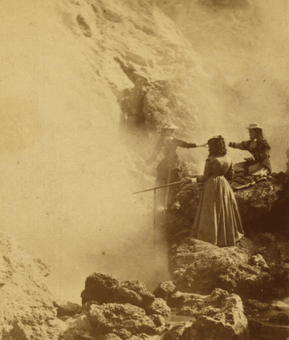
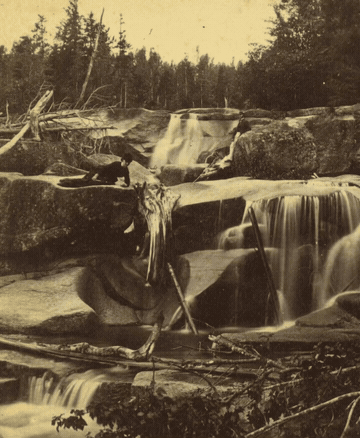
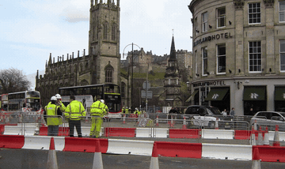
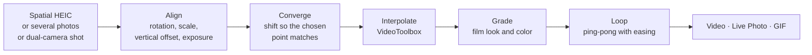
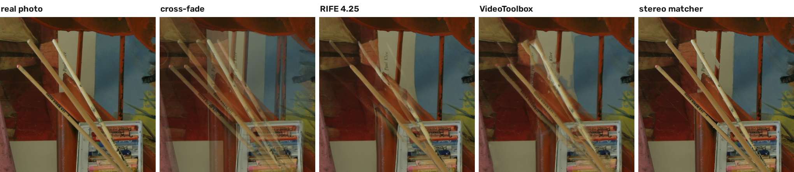

<p align="center"></p>

<h1 align="center">Wiggle</h1>

<p align="center">Smooth wigglegrams from a stereo pair, made on your iPhone or Mac.</p>

<p align="center">
<a href="https://github.com/kpeeem/wiggle/releases/latest"></a>
<a href="https://github.com/kpeeem/wiggle/actions/workflows/release.yml"></a>


</p>

**English** · [Русский](README.ru.md)

> **TL;DR** — Wiggle turns two or more views of a scene into a smooth looping wigglegram. Shoot with both iPhone cameras at once, open a spatial photo, or chain a few photos taken with a sideways step. The in-between viewpoints come from Apple's on-device neural frame interpolation, nothing leaves the device. The Mac app is a download, the iPhone app builds with your own provisioning profile. English, Русский and 日本語.

*Above: an 1870s stereo card of Diana's Baths, New Hampshire, by John P. Soule. Left: the classic two-frame wiggle. Right: the same two frames with generated in-between views.*

## Features

| | |
|---|---|
| **Camera first** | The iPhone app opens into a dark viewfinder. One press fires the wide and ultra wide cameras together, no Spatial mode needed |
| **Spatial photos** | Reads the stereo pair from iPhone spatial HEIC files by their metadata, not by file order |
| **Any number of photos** | Two, four or eight shots with a sideways step are aligned and chained, with frames generated between each neighbouring pair |
| **Auto alignment** | Removes rotation, scale difference, vertical offset and exposure difference between frames |
| **Convergence point** | Tap the subject and it stays still while the rest of the scene swings around it |
| **Film looks and grading** | Chrome, Fade, Instant, Process, Transfer, Tonal, Mono, Noir with live thumbnails, plus exposure, contrast, saturation, warmth and vignette |
| **Export** | HEVC or H.264 video, Live Photo, GIF. Three seconds by default, loops without a seam |
| **Three languages** | English, Russian and Japanese, picked from the system language |

## Screenshots

<p align="center">

&nbsp;&nbsp;

&nbsp;&nbsp;

</p>

<p align="center"></p>

## Gallery

Real stereo pairs from Wikimedia Commons run through the app's own pipeline: nine generated frames between the two views, convergence on the subject.

| | | |
|---|---|---|
|  |  |  |
| Eadweard Muybridge, *Cooking eggs at the Witches' Cauldron*, 1870s | John P. Soule, *Echo Lake, North Conway*, 1860s | John P. Soule, *Diana's Baths, North Conway*, 1860s |
|  |  |  |
| A boulder on asteroid Bennu, NASA OSIRIS-REx | Tay Road Bridge, Dundee | Shandwick Place, Edinburgh |

## Install

### iPhone

Requires iOS 26, Developer Mode, a development provisioning profile that lists your iPhone and its certificate in the keychain.

```bash
git clone https://github.com/kpeeem/wiggle.git && cd wiggle
```

```bash
WIGGLE_PROFILE=path/to/Development.mobileprovision ./scripts/deploy_ios.sh
```

The script builds the app, signs it locally with the profile while keeping the app's own bundle ID, installs it on the connected iPhone and launches it. Hold the phone horizontally to shoot: only then do the two lenses sit side by side.

### Mac

Download `Wiggle-1.0.1.zip` from [Releases](https://github.com/kpeeem/wiggle/releases/latest), unzip, move **Wiggle** to `/Applications` and clear the download quarantine. The build is ad-hoc signed, not notarized. Requires macOS 26 on Apple silicon.

```bash
xattr -dr com.apple.quarantine /Applications/Wiggle.app
```

Drop a spatial HEIC or a few photos into the window, click the subject, press ⌘E.

Check that the zip was built by this repository's workflow:

```bash
gh attestation verify Wiggle-1.0.1.zip -R kpeeem/wiggle
```

To build it yourself you need Xcode and XcodeGen:

```bash
brew install xcodegen
```

```bash
git clone https://github.com/kpeeem/wiggle.git && cd wiggle && ./scripts/build_app.sh
```

<details>
<summary><b>How it works</b></summary>



1. **Read.** A spatial photo holds a regular 2D photo and the two eyes. The eyes come from the stereo-pair group in the metadata: on iPhone 16 the left eye is stored after the right. In the iPhone camera the ultra wide frame is cropped to the wide camera's field of view.
2. **Align.** Hundreds of matching patches give a robust fit that removes rotation, scale difference and vertical offset. Brightness and contrast are matched to the reference frame.
3. **Converge.** Each frame is shifted horizontally so the chosen point lines up. It stands still, and the generated frames only cover half the disparity.
4. **Interpolate.** Apple's neural frame rate conversion in VideoToolbox builds the in-between views on device. No model ships with the app.
5. **Loop.** Frames play back and forth with easing at the ends and are written with AVFoundation or ImageIO.

</details>

<details>
<summary><b>Benchmarks</b></summary>

The [Middlebury stereo datasets](https://vision.middlebury.edu/stereo/data/) photograph each scene from seven evenly spaced positions, so the real in-between views are known. The outer views go in, the generated frames are compared with the real ones. PSNR in dB, higher is better. Frames about 1300×1110 px, near objects shift up to 190 px, MacBook Pro M1 Max.

| Engine | Aloe | Art | Baby1 | Mean | Time |
|---|---|---|---|---|---|
| Cross-fade | 24.4 | 20.3 | 31.9 | 25.5 | 0.001 s per frame |
| RIFE 4.25 on MLX | 31.3 | 25.9 | 37.6 | 31.6 | 0.20 s per frame |
| **VideoToolbox** (used by the apps) | 32.4 | 27.4 | 38.4 | 32.7 | 0.03 s per frame |
| Stereo matcher and depth-aware warp | 37.7 | 34.2 | 41.0 | 37.6 | 68 s per pair |



Frame interpolators place large objects and backgrounds correctly but turn thin objects in front of a distant background into ghosts. FoundationStereo with a depth-aware warp keeps the brushes whole, but needs over a minute per pair and 20–23 GB of memory, so the apps use VideoToolbox.

```bash
./scripts/setup.sh && ./scripts/fetch_data.sh && uv run python evaluate.py
```

</details>

<details>
<summary><b>Shooting tips</b></summary>

| | |
|---|---|
| **In Wiggle** | Hold the phone horizontally and press the shutter. Both rear cameras fire together |
| **Spatial photos** | iPhone 15 Pro with iOS 18.1 or later, all iPhone 16 and iPhone 17 models. Camera → Spatial → landscape |
| **Distance** | The lenses are about 19 mm apart, so depth is subtle. Keep the subject 0.6–1 m away with the background far behind it |
| **Transfer to a Mac** | AirDrop with "All Photos Data" or export the unmodified original from Photos. Messengers drop the second image |

</details>

<details>
<summary><b>Python prototype and project layout</b></summary>

The research prototype runs four interchangeable engines (`vt`, `rife`, `stereo`, `blend`) behind one `run LEFT RIGHT --phases … --out DIR` interface. Requires [uv](https://docs.astral.sh/uv/) and ffmpeg.

```bash
./scripts/setup.sh && uv run python wiggle.py IMG_0001.HEIC --out out/shot
```

| Path | What it is |
|---|---|
| `app/Core` | Shared Swift core: loading, alignment, interpolation, grading, export |
| `app/Shared` | Project model, settings and preview shared by both apps |
| `app/Wiggle`, `app/WiggleiOS` | Mac window, iPhone camera and editor |
| `app/CLI` | `wiggle-cli`, the same core from the command line |
| `wiggle.py`, `engines/` | Prototype pipeline and engines |
| `evaluate.py`, `montage.py` | Benchmarks and comparison images |
| `scripts/` | Build, deploy, setup and demo-data scripts |

</details>

<details>
<summary><b>Limitations</b></summary>

- Thin objects in front of a distant background can ghost. A lightweight Core ML stereo matcher would fix it on device.
- VideoToolbox refuses frames where both sides fall in 1441–1920 px. The app upscales slightly to work around it.
- The first run at a new frame size takes 12–20 s while the system compiles the model.
- The iOS Simulator has no frame interpolation: there the app shows a plain two-frame wiggle.

</details>

## Credits

- Gallery photos from Wikimedia Commons: Eadweard Muybridge and John P. Soule stereo cards and the NASA/Goddard/University of Arizona image of Bennu are in the public domain. [Shandwick Place, Edinburgh](https://commons.wikimedia.org/wiki/File:Edinburgh_Shandwick_H09439.jpg) by Carelmarters and [Tay Road Bridge](https://commons.wikimedia.org/wiki/File:Tay_Road_Bridge_parallel-view_3D.jpg) by DiscDepotDundee.co.uk are [CC BY-SA 3.0](https://creativecommons.org/licenses/by-sa/3.0/), and the GIFs and screenshots made from them are shared under the same license.
- Benchmark scenes: [Middlebury Stereo Datasets](https://vision.middlebury.edu/stereo/data/), D. Scharstein, H. Hirschmüller, C. Pal, R. Szeliski.
- [RIFE](https://github.com/hzwer/Practical-RIFE) and its MLX port [rife-mlx](https://github.com/jstepien/rife-mlx), MIT. [FoundationStereo](https://github.com/NVlabs/FoundationStereo) by NVIDIA, non-commercial, downloaded by the setup script and not redistributed.

## License

[MIT](LICENSE). Third-party photos, models and datasets keep their own licenses listed above.
