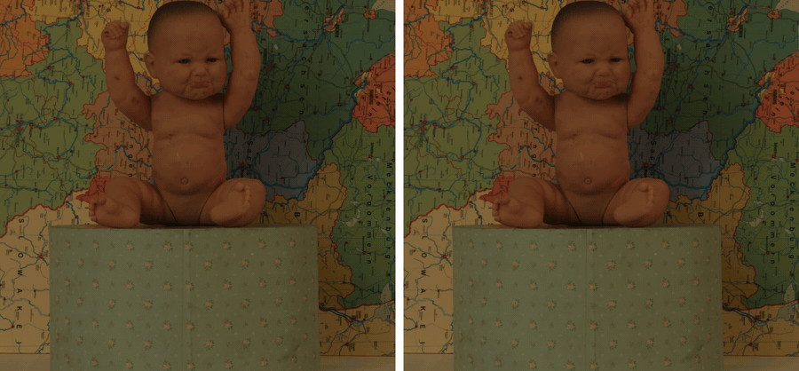
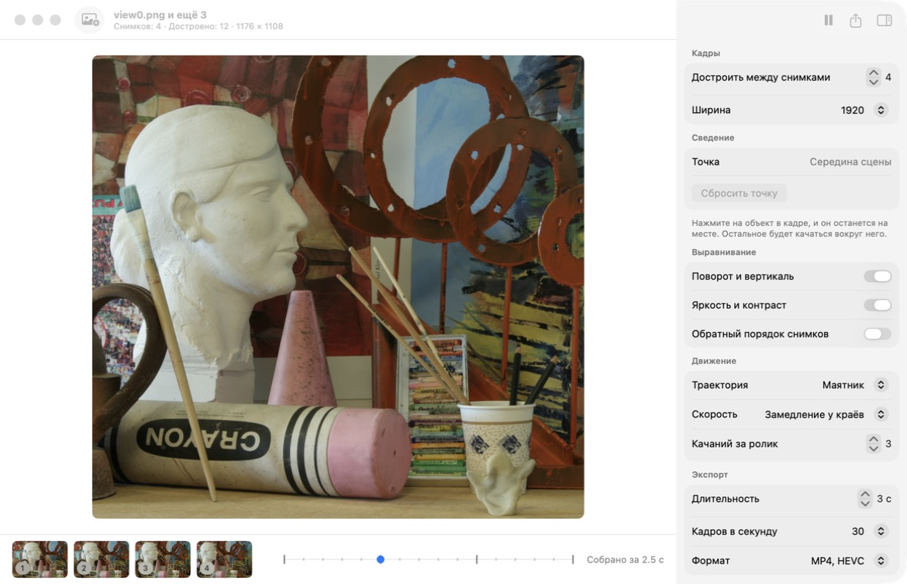
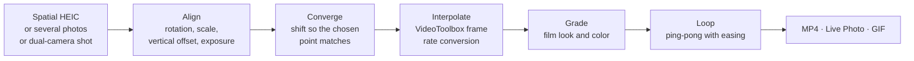
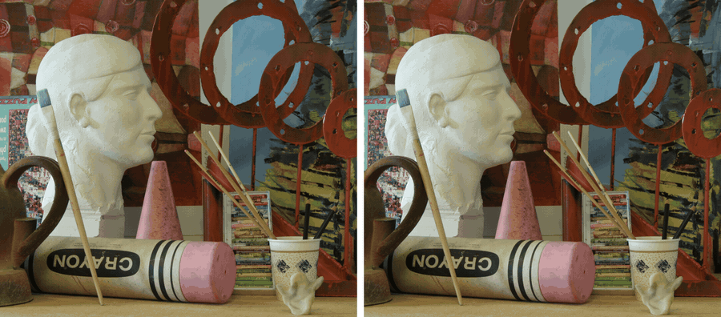

# Wiggle

**English** · [Русский](README.ru.md)

Smooth wigglegrams from a stereo pair. Wiggle takes an iPhone spatial photo, a shot from both rear cameras, or a few photos of one scene, builds the in-between viewpoints with on-device neural frame interpolation, and loops them into a video, a Live Photo or a GIF. Everything runs locally.



*Left: the classic two-frame wiggle. Right: the same two frames with generated in-between viewpoints.*

   

## What's inside

| | |
|---|---|
| **iPhone app** | Opens straight into a dark viewfinder. One press captures the wide and ultra wide cameras at the same moment, no Spatial mode needed |
| **Mac app** | Drop a spatial photo or several shots of a scene, tune the loop, export |
| **Any number of photos** | Two, four, eight shots taken with a sideways step are aligned and chained, with frames generated between every neighbouring pair |
| **Convergence point** | Tap the subject and it stays still while everything else swings around it |
| **Film looks and grading** | Built-in Core Image looks (Chrome, Fade, Instant, Noir and more), exposure, contrast, saturation, warmth, vignette, with live thumbnails |
| **Export** | HEVC or H.264 MP4, Live Photo, GIF. Three seconds by default, seamless loop |
| **Research prototype** | Python harness with four interchangeable engines, ground-truth benchmarks and a depth-based renderer |



## Quick start

### Mac app

Requires macOS 26 on Apple silicon, Xcode and [XcodeGen](https://github.com/yonaskolb/XcodeGen).

```bash
git clone https://github.com/kpeeem/wiggle.git
```

```bash
cd wiggle
```

```bash
./scripts/build_app.sh
```

The script prints the path to the built `Wiggle.app`. Drag a spatial HEIC or a few photos into the window, click the subject, press ⌘E.

### iPhone app

Requires an iPhone with iOS 26, Developer Mode, a development provisioning profile that lists the phone, and the profile's certificate in your keychain.

```bash
WIGGLE_PROFILE=path/to/Development.mobileprovision ./scripts/deploy_ios.sh
```

The script builds the app unsigned, signs it locally with the profile's certificate and entitlements while keeping the app's own bundle ID, installs it on the first connected iPhone and launches it. Hold the phone horizontally to shoot: only then do the two lenses sit side by side.

### Python prototype

Requires [uv](https://docs.astral.sh/uv/) and ffmpeg.

```bash
./scripts/setup.sh
```

```bash
uv run python wiggle.py IMG_0001.HEIC --out out/shot
```

```bash
uv run python wiggle.py left.jpg right.jpg --converge 0.5 0.6 --out out/shot
```

## How it works



1. **Read.** A spatial photo holds three images: a regular 2D photo and the two eyes. Wiggle takes the eyes from the stereo-pair group in the metadata instead of trusting the file order, since on iPhone 16 the left eye comes after the right. In the iPhone app the dual-camera shot is used instead: the ultra wide frame is cropped to the wide camera's field of view.
2. **Align.** Hundreds of matching patches between the frames give a robust fit that removes rotation, scale difference and vertical offset. Brightness and contrast of each frame are matched to the reference.
3. **Converge.** Each frame is shifted horizontally so the chosen point lines up. That point stands still, and the generated frames only have to cover half the disparity.
4. **Interpolate.** The in-between viewpoints come from Apple's neural frame rate conversion in VideoToolbox, available on macOS 15.4 and iOS 26. No model ships with the app.
5. **Loop.** Frames play back and forth with easing at the ends and are written with AVFoundation or ImageIO.

## Benchmarks

The [Middlebury stereo datasets](https://vision.middlebury.edu/stereo/data/) photograph each scene from seven evenly spaced positions, so the real in-between views are known. The outer views go in, the generated frames are compared with the real ones. PSNR in dB, higher is better. Frames about 1300×1110 px, near objects shift up to 190 px, MacBook Pro M1 Max.

| Engine | Aloe | Art | Baby1 | Mean | Time |
|---|---|---|---|---|---|
| Cross-fade | 24.4 | 20.3 | 31.9 | 25.5 | 0.001 s per frame |
| RIFE 4.25 on MLX | 31.3 | 25.9 | 37.6 | 31.6 | 0.20 s per frame |
| **VideoToolbox** (used by the apps) | 32.4 | 27.4 | 38.4 | 32.7 | 0.03 s per frame |
| Stereo matcher and depth-aware warp | 37.7 | 34.2 | 41.0 | 37.6 | 68 s per pair |


Frame interpolators place large objects and backgrounds correctly but turn thin objects in front of a distant background into ghosts. The stereo matcher, FoundationStereo plus a depth-aware forward warp, keeps the brushes whole, but takes over a minute per pair and 20–23 GB of memory, so the apps use VideoToolbox.



Reproduce:

```bash
./scripts/fetch_data.sh
```

```bash
uv run python evaluate.py
```

## Shooting on iPhone

| | |
|---|---|
| **In Wiggle** | Hold the phone horizontally and press the shutter. Both rear cameras fire together |
| **Spatial photos** | iPhone 15 Pro with iOS 18.1 or later, all iPhone 16 and iPhone 17 models. Camera → Spatial → landscape |
| **Distance** | The lenses are about 19 mm apart, so depth is subtle. Keep the subject 0.6–1 m away with the background far behind it |
| **Transfer to a Mac** | AirDrop with "All Photos Data" or export the unmodified original from Photos. Messengers drop the second image |

## Project layout

| Path | What it is |
|---|---|
| `app/Core` | Shared Swift core: loading, alignment, interpolation, grading, export |
| `app/Shared` | Project model, settings and preview shared by both apps |
| `app/Wiggle` | Mac window |
| `app/WiggleiOS` | iPhone camera and editor |
| `app/CLI` | `wiggle-cli`, the same core from the command line |
| `wiggle.py` | Prototype pipeline from photos to loop |
| `engines/` | Prototype engines: `vt`, `rife`, `stereo`, `blend`, each a `run LEFT RIGHT --phases … --out DIR` program |
| `evaluate.py`, `montage.py` | Benchmarks and comparison images |
| `scripts/` | Setup, build, deploy and test-data scripts |

## Limitations

- Thin objects in front of a distant background can ghost. A lightweight Core ML stereo matcher would fix it on device.
- VideoToolbox frame interpolation refuses sessions where both sides fall in 1441–1920 px. The engine works around it by upscaling slightly.
- The first run at a new frame size takes 12–20 s while the system compiles the model.
- Frame interpolation is not available in the iOS Simulator, use a device.

## Credits

- Test scenes: [Middlebury Stereo Datasets](https://vision.middlebury.edu/stereo/data/), D. Scharstein, H. Hirschmüller, C. Pal, R. Szeliski (2005, 2006).
- [RIFE](https://github.com/hzwer/Practical-RIFE) by hzwer and the MLX port [rife-mlx](https://github.com/jstepien/rife-mlx), MIT.
- [FoundationStereo](https://github.com/NVlabs/FoundationStereo) by NVIDIA, research and non-commercial license. Weights are downloaded by the setup script, not redistributed.
- Apple VideoToolbox, Core Image, AVFoundation and ImageIO.
