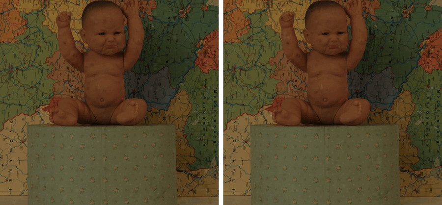
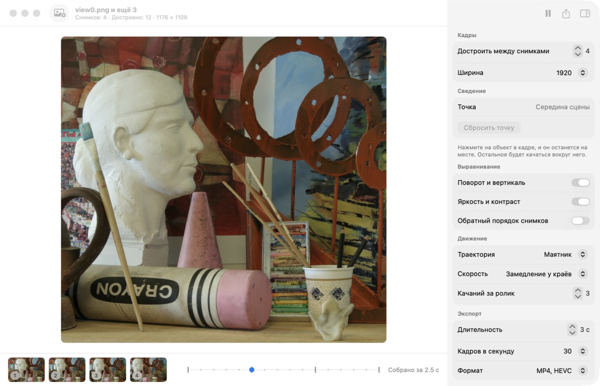
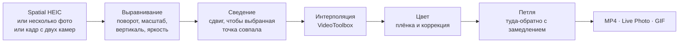
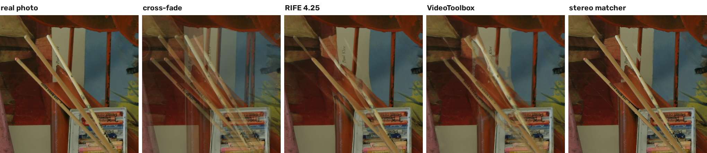
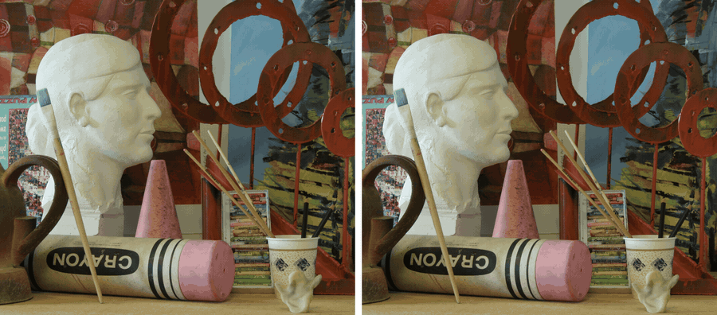

# Wiggle

[English](README.md) · **Русский**

Плавные wiggle-анимации из стереопары. Wiggle берёт spatial-снимок с iPhone, кадр сразу с двух камер телефона или несколько фото одной сцены, достраивает промежуточные ракурсы встроенной нейросетевой интерполяцией и собирает зацикленный ролик, Live Photo или GIF. Всё считается на устройстве.



*Слева классический wiggle из двух кадров. Справа те же два кадра и достроенные ракурсы между ними.*

   

## Что внутри

| | |
|---|---|
| **Приложение для iPhone** | Открывается сразу тёмным видоискателем. Одно нажатие снимает широкой и сверхширокой камерой одновременно, режим Spatial не нужен |
| **Приложение для Mac** | Перетащите spatial-снимок или несколько кадров сцены, настройте петлю, экспортируйте |
| **Сколько угодно снимков** | Два, четыре, восемь кадров со сдвигом вбок выравниваются и идут цепочкой, кадры достраиваются между каждой соседней парой |
| **Точка сведения** | Коснитесь объекта, и он стоит на месте, а остальное качается вокруг него |
| **Плёнки и цвет** | Встроенные фильтры Core Image (Chrome, Fade, Instant, Noir и другие), экспозиция, контраст, насыщенность, теплота, виньетка, живые миниатюры |
| **Экспорт** | MP4 в HEVC или H.264, Live Photo, GIF. По умолчанию 3 секунды, петля без шва |
| **Исследовательский прототип** | Обвязка на Python с четырьмя взаимозаменяемыми движками, замерами по эталону и рендером по карте глубины |



## Быстрый старт

### Приложение для Mac

Нужны macOS 26 на Apple Silicon, Xcode и [XcodeGen](https://github.com/yonaskolb/XcodeGen).

```bash
git clone https://github.com/kpeeem/wiggle.git
```

```bash
cd wiggle
```

```bash
./scripts/build_app.sh
```

Скрипт печатает путь к собранному `Wiggle.app`. Перетащите в окно spatial HEIC или несколько фото, щёлкните по объекту, нажмите ⌘E.

### Приложение для iPhone

Нужны iPhone с iOS 26, режим разработчика, профиль разработчика с этим телефоном и сертификат этого профиля в связке ключей.

```bash
WIGGLE_PROFILE=путь/к/Development.mobileprovision ./scripts/deploy_ios.sh
```

Скрипт собирает приложение без подписи, подписывает его локально сертификатом и entitlements из профиля, сохраняя собственный bundle ID приложения, ставит на первый подключённый iPhone и запускает. Снимать нужно, держа телефон горизонтально: только так объективы стоят рядом.

### Прототип на Python

Нужны [uv](https://docs.astral.sh/uv/) и ffmpeg.

```bash
./scripts/setup.sh
```

```bash
uv run python wiggle.py IMG_0001.HEIC --out out/shot
```

```bash
uv run python wiggle.py left.jpg right.jpg --converge 0.5 0.6 --out out/shot
```

## Как это работает



1. **Чтение.** В spatial-снимке три картинки: обычное 2D-фото и два глаза. Глаза берутся по группе стереопары в метаданных, а не по порядку в файле: у iPhone 16 левый глаз идёт после правого. В приложении для iPhone вместо этого используется кадр с двух камер: сверхширокий обрезается до угла обзора широкого.
2. **Выравнивание.** Сотни совпадающих фрагментов дают устойчивую подгонку, которая убирает поворот, разницу масштаба и сдвиг по вертикали. Яркость и контраст каждого кадра подгоняются под опорный.
3. **Сведение.** Каждый кадр сдвигается по горизонтали так, чтобы выбранная точка совпала. Она стоит на месте, а достроенным кадрам остаётся покрыть вдвое меньший сдвиг.
4. **Интерполяция.** Промежуточные ракурсы даёт нейросетевая интерполяция кадров Apple из VideoToolbox, она есть в macOS 15.4 и iOS 26. Своих моделей приложение не везёт.
5. **Петля.** Кадры идут туда и обратно с замедлением у краёв и записываются через AVFoundation или ImageIO.

## Замеры

В [датасетах Middlebury](https://vision.middlebury.edu/stereo/data/) каждая сцена снята с семи равноотстоящих позиций, поэтому настоящие промежуточные ракурсы известны. Крайние снимки идут на вход, достроенные кадры сравниваются с настоящими. PSNR в дБ, больше лучше. Кадры около 1300×1110 px, ближние объекты сдвигаются до 190 px, MacBook Pro M1 Max.

| Движок | Aloe | Art | Baby1 | Среднее | Время |
|---|---|---|---|---|---|
| Простое смешивание | 24,4 | 20,3 | 31,9 | 25,5 | 0,001 с на кадр |
| RIFE 4.25 на MLX | 31,3 | 25,9 | 37,6 | 31,6 | 0,20 с на кадр |
| **VideoToolbox** (в приложениях) | 32,4 | 27,4 | 38,4 | 32,7 | 0,03 с на кадр |
| Стерео-матчер и перенос по глубине | 37,7 | 34,2 | 41,0 | 37,6 | 68 с на пару |



Интерполяторы кадров ставят на место крупные объекты и фон, но тонкие предметы перед далёким фоном превращают в полупрозрачные копии. Стерео-матчер (FoundationStereo и перенос пикселей с учётом глубины) сохраняет кисти целыми, но считает пару больше минуты и занимает 20–23 ГБ памяти. Поэтому в приложениях используется VideoToolbox.



Повторить замер:

```bash
./scripts/fetch_data.sh
```

```bash
uv run python evaluate.py
```

## Съёмка на iPhone

| | |
|---|---|
| **В Wiggle** | Держите телефон горизонтально и нажмите спуск. Обе задние камеры снимают одновременно |
| **Spatial-снимки** | iPhone 15 Pro с iOS 18.1 и новее, все iPhone 16 и iPhone 17. Камера → Spatial → горизонтально |
| **Расстояние** | Объективы стоят примерно в 19 мм друг от друга, поэтому объём слабый. Держите объект в 60–100 см, а фон далеко за ним |
| **Перенос на Mac** | AirDrop с опцией «Все данные фото» или экспорт оригинала без изменений из «Фото». Мессенджеры выбрасывают второй кадр |

## Устройство проекта

| Путь | Что это |
|---|---|
| `app/Core` | Общее ядро на Swift: чтение, выравнивание, интерполяция, цвет, экспорт |
| `app/Shared` | Модель проекта, настройки и предпросмотр, общие для обоих приложений |
| `app/Wiggle` | Окно приложения для Mac |
| `app/WiggleiOS` | Камера и редактор для iPhone |
| `app/CLI` | `wiggle-cli`, то же ядро из командной строки |
| `wiggle.py` | Конвейер прототипа от снимков до петли |
| `engines/` | Движки прототипа: `vt`, `rife`, `stereo`, `blend`, каждый — программа `run LEFT RIGHT --phases … --out DIR` |
| `evaluate.py`, `montage.py` | Замеры и сравнительные картинки |
| `scripts/` | Установка, сборка, установка на телефон, загрузка тестовых данных |

## Ограничения

- Тонкие предметы перед далёким фоном могут двоиться. На устройстве это исправил бы лёгкий стерео-матчер под Core ML.
- Интерполяция VideoToolbox не принимает кадр, у которого обе стороны в диапазоне 1441–1920 px. Движок обходит это небольшим увеличением.
- Первый запуск на новом размере кадра занимает 12–20 с, пока система компилирует модель.
- В симуляторе iOS интерполяции кадров нет, проверять нужно на устройстве.

## Благодарности

- Тестовые сцены: [Middlebury Stereo Datasets](https://vision.middlebury.edu/stereo/data/), D. Scharstein, H. Hirschmüller, C. Pal, R. Szeliski (2005, 2006).
- [RIFE](https://github.com/hzwer/Practical-RIFE) от hzwer и порт под MLX [rife-mlx](https://github.com/jstepien/rife-mlx), MIT.
- [FoundationStereo](https://github.com/NVlabs/FoundationStereo) от NVIDIA, исследовательская некоммерческая лицензия. Веса скачивает скрипт установки, в репозитории их нет.
- Apple VideoToolbox, Core Image, AVFoundation и ImageIO.
