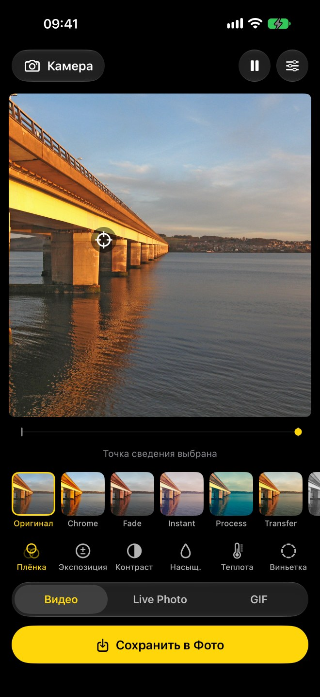
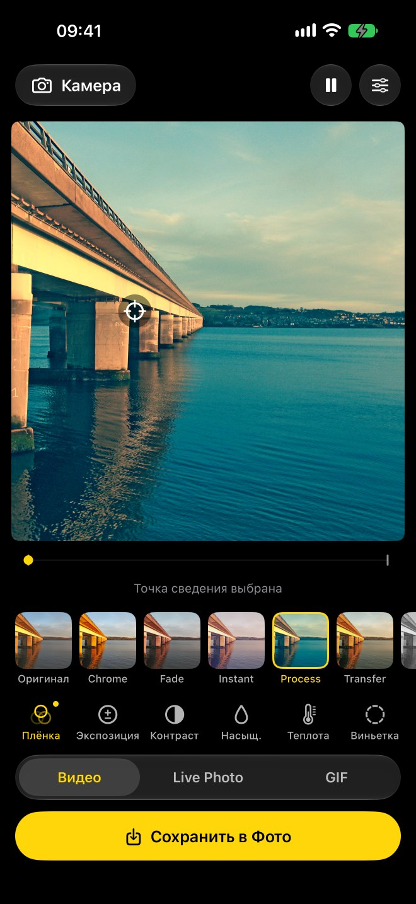
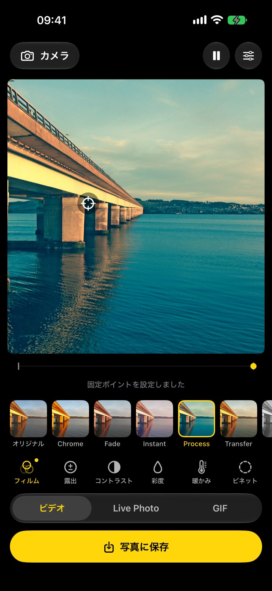
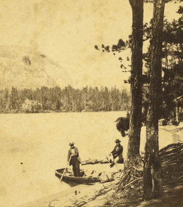
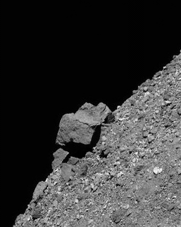
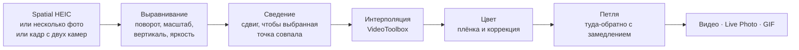

<p align="center"></p>

<h1 align="center">Wiggle</h1>

<p align="center">Плавные wiggle-анимации из стереопары прямо на iPhone или Mac.</p>

<p align="center">
<a href="https://github.com/kpeeem/wiggle/releases/latest"></a>
<a href="https://github.com/kpeeem/wiggle/actions/workflows/release.yml"></a>


</p>

[English](README.md) · **Русский**

> **TL;DR** — Wiggle превращает два и больше ракурсов сцены в плавную зацикленную wiggle-анимацию. Можно снять обеими камерами iPhone сразу, открыть spatial-снимок или склеить несколько фото со сдвигом вбок. Промежуточные ракурсы достраивает встроенная в систему нейросетевая интерполяция Apple, всё остаётся на устройстве. Приложение для Mac скачивается готовым, для iPhone собирается своим профилем разработчика. Русский, English и 日本語.

*Наверху: стереокарточка 1870-х годов «Diana's Baths» Джона П. Соула, Нью-Гэмпшир. Слева классический wiggle из двух кадров, справа те же два кадра с достроенными ракурсами.*

## Возможности

| | |
|---|---|
| **Сначала камера** | Приложение для iPhone открывается тёмным видоискателем. Одно нажатие снимает широкой и сверхширокой камерой сразу, режим Spatial не нужен |
| **Spatial-снимки** | Пара глаз берётся из метаданных spatial HEIC, а не по порядку картинок в файле |
| **Сколько угодно снимков** | Два, четыре, восемь кадров со сдвигом вбок выравниваются и идут цепочкой, кадры достраиваются между каждой соседней парой |
| **Автовыравнивание** | Убирает поворот, разницу масштаба, сдвиг по вертикали и разницу в экспозиции |
| **Точка сведения** | Коснитесь объекта, и он стоит на месте, а остальная сцена качается вокруг него |
| **Плёнки и цвет** | Chrome, Fade, Instant, Process, Transfer, Tonal, Mono, Noir с живыми миниатюрами, а ещё экспозиция, контраст, насыщенность, теплота и виньетка |
| **Экспорт** | Видео HEVC или H.264, Live Photo, GIF. По умолчанию 3 секунды, петля без шва |
| **Три языка** | Русский, английский и японский, выбираются по языку системы |

## Скриншоты

<p align="center">

&nbsp;&nbsp;

&nbsp;&nbsp;

</p>

<p align="center"></p>

## Галерея

Настоящие стереопары с Wikimedia Commons, прогнанные через конвейер приложения: девять достроенных кадров между ракурсами, сведение на главном объекте.

| | | |
|---|---|---|
|  |  |  |
| Эдвард Мейбридж, *Cooking eggs at the Witches' Cauldron*, 1870-е | Джон П. Соул, *Echo Lake, North Conway*, 1860-е | Джон П. Соул, *Diana's Baths, North Conway*, 1860-е |
|  |  |  |
| Валун на астероиде Бенну, NASA OSIRIS-REx | Мост Тей, Данди | Шандвик-плейс, Эдинбург |

## Установка

### iPhone

Нужны iOS 26, режим разработчика, профиль разработчика с вашим iPhone и его сертификат в связке ключей.

```bash
git clone https://github.com/kpeeem/wiggle.git && cd wiggle
```

```bash
WIGGLE_PROFILE=путь/к/Development.mobileprovision ./scripts/deploy_ios.sh
```

Скрипт собирает приложение, подписывает его локально профилем, сохраняя собственный bundle ID приложения, ставит на подключённый iPhone и запускает. Снимать нужно, держа телефон горизонтально: только так объективы стоят рядом.

### Mac

Скачайте `Wiggle-1.0.0.zip` из [релизов](https://github.com/kpeeem/wiggle/releases/latest), распакуйте, перенесите **Wiggle** в `/Applications` и снимите карантин. Сборка подписана ad-hoc, без нотаризации. Нужна macOS 26 на Apple Silicon.

```bash
xattr -dr com.apple.quarantine /Applications/Wiggle.app
```

Перетащите в окно spatial HEIC или несколько фото, щёлкните по объекту, нажмите ⌘E.

Проверить, что архив собран workflow этого репозитория:

```bash
gh attestation verify Wiggle-1.0.0.zip -R kpeeem/wiggle
```

Собрать самому: нужны Xcode и XcodeGen.

```bash
brew install xcodegen
```

```bash
git clone https://github.com/kpeeem/wiggle.git && cd wiggle && ./scripts/build_app.sh
```

<details>
<summary><b>Как это работает</b></summary>



1. **Чтение.** В spatial-снимке лежат обычное 2D-фото и два глаза. Глаза берутся по группе стереопары в метаданных: у iPhone 16 левый глаз записан после правого. В камере iPhone сверхширокий кадр обрезается до угла обзора широкого.
2. **Выравнивание.** Сотни совпадающих фрагментов дают устойчивую подгонку, которая убирает поворот, разницу масштаба и сдвиг по вертикали. Яркость и контраст подгоняются под опорный кадр.
3. **Сведение.** Каждый кадр сдвигается по горизонтали так, чтобы выбранная точка совпала. Она стоит на месте, а достроенным кадрам остаётся покрыть вдвое меньший сдвиг.
4. **Интерполяция.** Промежуточные ракурсы на устройстве строит нейросетевая интерполяция кадров Apple из VideoToolbox. Своих моделей приложение не везёт.
5. **Петля.** Кадры идут туда и обратно с замедлением у краёв и записываются через AVFoundation или ImageIO.

</details>

<details>
<summary><b>Замеры</b></summary>

В [датасетах Middlebury](https://vision.middlebury.edu/stereo/data/) каждая сцена снята с семи равноотстоящих позиций, поэтому настоящие промежуточные ракурсы известны. Крайние снимки идут на вход, достроенные кадры сравниваются с настоящими. PSNR в дБ, больше лучше. Кадры около 1300×1110 px, ближние объекты сдвигаются до 190 px, MacBook Pro M1 Max.

| Движок | Aloe | Art | Baby1 | Среднее | Время |
|---|---|---|---|---|---|
| Простое смешивание | 24,4 | 20,3 | 31,9 | 25,5 | 0,001 с на кадр |
| RIFE 4.25 на MLX | 31,3 | 25,9 | 37,6 | 31,6 | 0,20 с на кадр |
| **VideoToolbox** (в приложениях) | 32,4 | 27,4 | 38,4 | 32,7 | 0,03 с на кадр |
| Стерео-матчер и перенос по глубине | 37,7 | 34,2 | 41,0 | 37,6 | 68 с на пару |


Интерполяторы кадров ставят на место крупные объекты и фон, но тонкие предметы перед далёким фоном превращают в полупрозрачные копии. FoundationStereo с переносом по глубине сохраняет кисти целыми, но считает пару больше минуты и занимает 20–23 ГБ памяти. Поэтому в приложениях используется VideoToolbox.

```bash
./scripts/setup.sh && ./scripts/fetch_data.sh && uv run python evaluate.py
```

</details>

<details>
<summary><b>Как снимать</b></summary>

| | |
|---|---|
| **В Wiggle** | Держите телефон горизонтально и нажмите спуск. Обе задние камеры снимают одновременно |
| **Spatial-снимки** | iPhone 15 Pro с iOS 18.1 и новее, все iPhone 16 и iPhone 17. Камера → Spatial → горизонтально |
| **Расстояние** | Объективы стоят примерно в 19 мм друг от друга, объём слабый. Держите объект в 60–100 см, а фон далеко за ним |
| **Перенос на Mac** | AirDrop с опцией «Все данные фото» или экспорт оригинала без изменений из «Фото». Мессенджеры выбрасывают второй кадр |

</details>

<details>
<summary><b>Прототип на Python и устройство проекта</b></summary>

Исследовательский прототип гоняет четыре взаимозаменяемых движка (`vt`, `rife`, `stereo`, `blend`) через один интерфейс `run LEFT RIGHT --phases … --out DIR`. Нужны [uv](https://docs.astral.sh/uv/) и ffmpeg.

```bash
./scripts/setup.sh && uv run python wiggle.py IMG_0001.HEIC --out out/shot
```

| Путь | Что это |
|---|---|
| `app/Core` | Общее ядро на Swift: чтение, выравнивание, интерполяция, цвет, экспорт |
| `app/Shared` | Модель проекта, настройки и предпросмотр, общие для обоих приложений |
| `app/Wiggle`, `app/WiggleiOS` | Окно для Mac, камера и редактор для iPhone |
| `app/CLI` | `wiggle-cli`, то же ядро из командной строки |
| `wiggle.py`, `engines/` | Конвейер и движки прототипа |
| `evaluate.py`, `montage.py` | Замеры и сравнительные картинки |
| `scripts/` | Сборка, установка, настройка и демо-данные |

</details>

<details>
<summary><b>Ограничения</b></summary>

- Тонкие предметы перед далёким фоном могут двоиться. На устройстве это исправил бы лёгкий стерео-матчер под Core ML.
- VideoToolbox не принимает кадры, у которых обе стороны в диапазоне 1441–1920 px. Приложение обходит это небольшим увеличением.
- Первый запуск на новом размере кадра занимает 12–20 с, пока система компилирует модель.
- В симуляторе iOS интерполяции кадров нет: там приложение показывает обычный wiggle из двух кадров.

</details>

## Благодарности

- Фотографии галереи с Wikimedia Commons: стереокарточки Эдварда Мейбриджа и Джона П. Соула и снимок Бенну от NASA/Goddard/University of Arizona находятся в общественном достоянии. [Шандвик-плейс, Эдинбург](https://commons.wikimedia.org/wiki/File:Edinburgh_Shandwick_H09439.jpg) автора Carelmarters и [мост Тей](https://commons.wikimedia.org/wiki/File:Tay_Road_Bridge_parallel-view_3D.jpg) от DiscDepotDundee.co.uk распространяются по [CC BY-SA 3.0](https://creativecommons.org/licenses/by-sa/3.0/), и сделанные из них гифки и скриншоты распространяются по той же лицензии.
- Сцены для замеров: [Middlebury Stereo Datasets](https://vision.middlebury.edu/stereo/data/), D. Scharstein, H. Hirschmüller, C. Pal, R. Szeliski.
- [RIFE](https://github.com/hzwer/Practical-RIFE) и его порт под MLX [rife-mlx](https://github.com/jstepien/rife-mlx), MIT. [FoundationStereo](https://github.com/NVlabs/FoundationStereo) от NVIDIA, некоммерческая лицензия, веса скачивает скрипт установки, в репозитории их нет.

## Лицензия

[MIT](LICENSE). У сторонних фотографий, моделей и датасетов свои лицензии, они перечислены выше.
